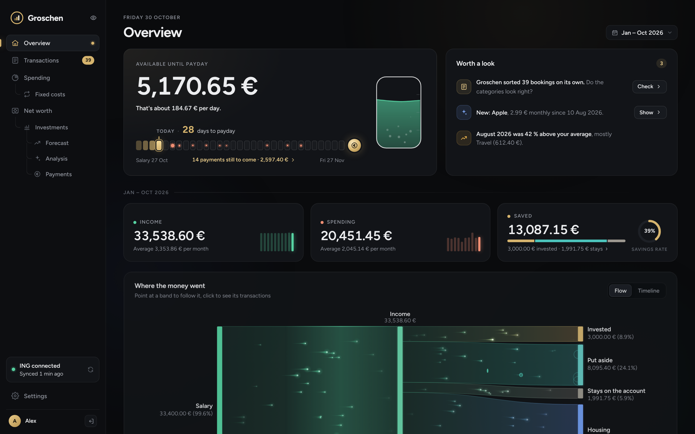
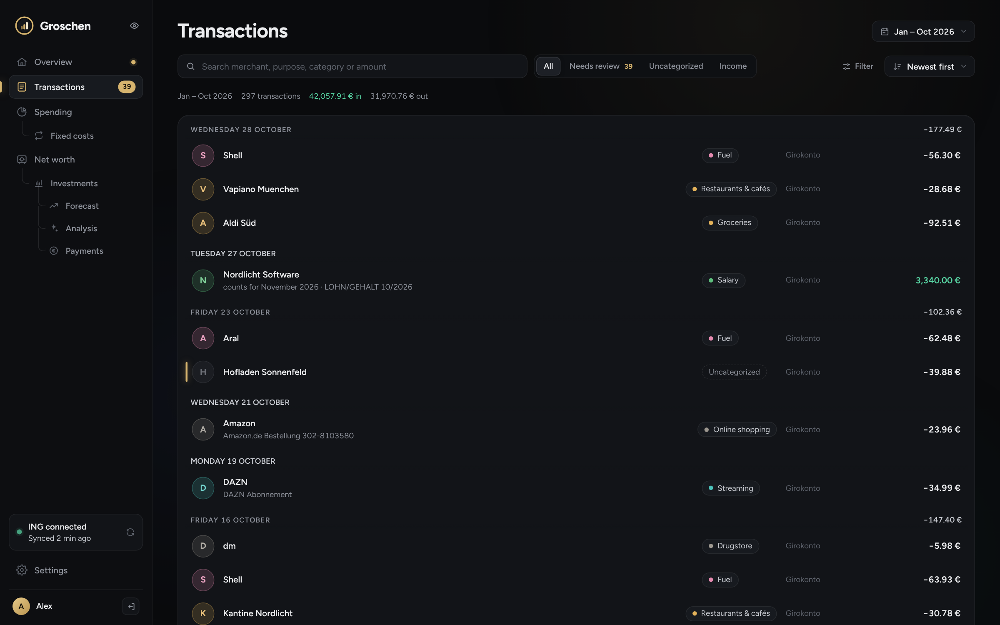
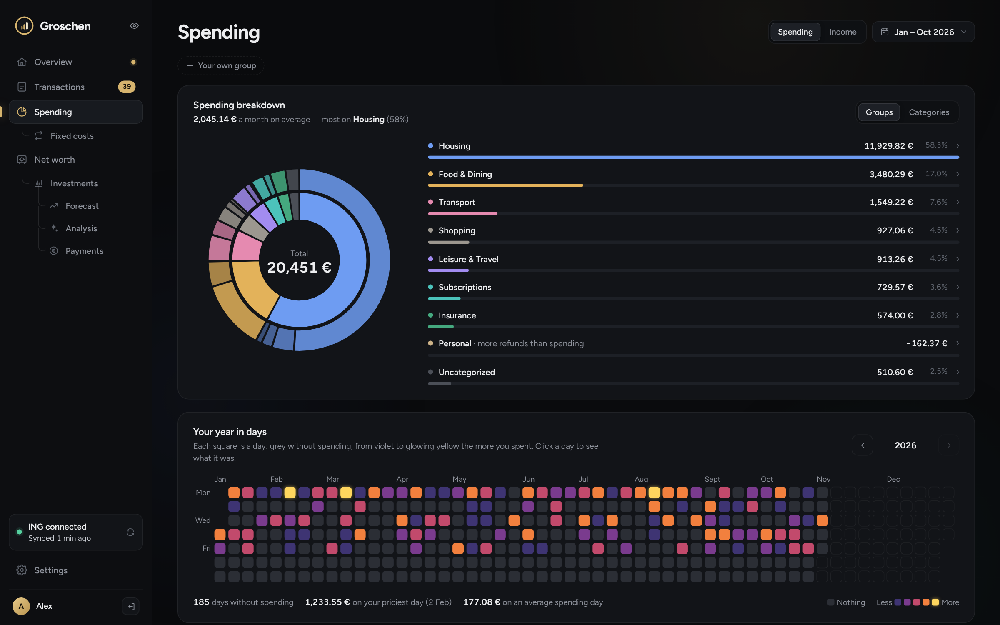
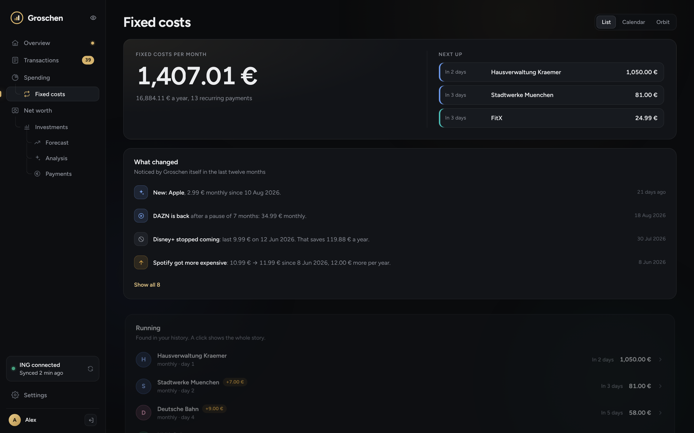
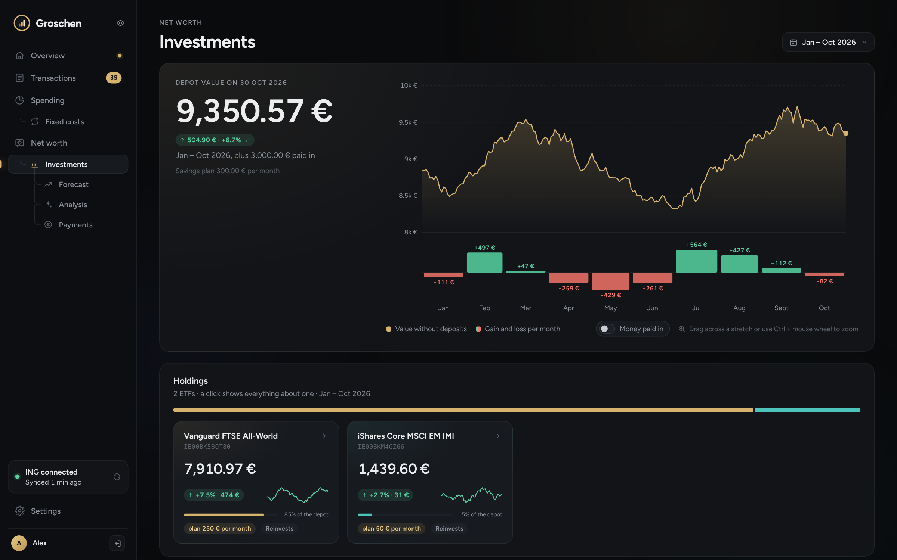
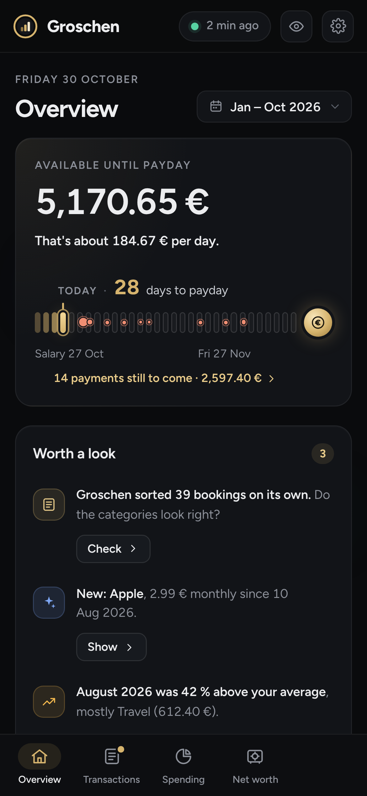

<p align="center">
  
</p>

<h1 align="center">Groschen</h1>

<p align="center">
  <b>A private, self-hosted finance dashboard for ING Germany.</b><br>
  Runs as one Docker container on your own server, sorts your money by itself with a small
  built-in AI model, and talks to nobody on the internet except your bank.
</p>

<p align="center">
  <a href="#install-on-unraid">Install</a> ·
  <a href="#try-it-with-demo-data">Try the demo</a> ·
  <a href="#whats-inside">Features</a> ·
  <a href="#privacy-and-network">Privacy</a> ·
  <a href="#development">Development</a>
</p>



<sub>All screenshots show the built-in demo data. The person, employer and amounts are invented.</sub>

## Highlights

- **Your data stays home.** SQLite in your appdata folder, no cloud account, no analytics, no
  web fonts. A network guard inside the app blocks every host except your bank.
- **Sorts itself.** About 500 known German merchants plus a small multilingual model on the CPU.
  It learns from every correction, spots own transfers, refunds and savings plans on its own.
- **Knows your month.** What is free until payday, which fixed costs are still to come, and which
  subscriptions got pricier, stopped or came back.
- **Depot without the noise.** Real gain and loss without counting the money you paid in,
  zoomable charts, a projection with 800 simulated futures.
- **Everything in the browser.** Setup wizard, bank connection, backups, passkeys: no config files.
  English and German.

## Screenshots

| | |
| --- | --- |
|  |  |
| **Transactions** with search, filters and a one-click review queue | **Spending** by group and category, and a year in days |
|  |  |
| **Fixed costs** that notice price changes, cancellations and comebacks | **Depot** value with monthly gain and loss, pay-ins left out |

<p align="center">
  
</p>

## Contents

- [What's inside](#whats-inside)
- [Privacy and network](#privacy-and-network)
- [ING: what to know](#ing-what-to-know)
- [Install on Unraid](#install-on-unraid)
- [Updates](#updates)
- [Try it with demo data](#try-it-with-demo-data)
- [Development](#development)

## What's inside

- **Setup wizard** on first start: your login, the ING connection, CSV import of older history,
  categorizer and schedule, first sync.
- **Overview**: what is free to spend until payday, with every charge still to come on a line to
  payday, a few hints worth a look, and where the money went (as a flow, a timeline or by month).
- **Transactions** (search, filters and a review queue where one click accepts a guess),
  **spending** by group and category with every day of the year, **fixed costs** (as a list, a
  calendar or an orbit), **net worth** and your own **groups** (a car, a flat you rent out).
  In English or German.
- **Fixed costs that keep themselves up to date**: Groschen notices when a subscription gets more
  expensive or cheaper, stops, starts, or comes back after a pause, and says so on the Overview.
- **Savings plans found on their own**: ETF savings plans, Kleingeld Plus and standing orders to
  the savings account show up under Net worth with every payment, no setup needed.
- **Less sorting by hand**: money moved to your own name (the Extra-Konto, a broker, an account at
  another bank) counts as moved, saved or invested, not spent; a refund cancels out the purchase it
  belongs to; payees get readable names ("VISA MCDONALDS 01234" becomes McDonald's, PayPal shows
  the shop behind it); a day's Kleingeld Plus round-ups are one line. Hints stay quiet about
  everyday shopping, and new merchant knowledge sorts existing bookings again after an update
  (never the ones you sorted).
- **Depot**: value against money paid in, with what each month (week, day) earned or lost in euros
  without counting the money paid in. Everything on the page follows the chosen period, and the
  charts zoom: drag across them, Ctrl + mouse wheel, or two fingers on a phone; the browser keeps
  the view. Behind tabs the rest: money-weighted and time-weighted return, volatility, Sharpe ratio
  against your Extra-Konto rate, drawdown, a monthly-returns heatmap, a projection with 800
  simulated futures, and a page for every ETF. Also the tax-free allowance (Sparerpauschbetrag).
- **One dark design**, calm and formal with small animations. The Animations setting (full, calm,
  off) and the system's reduced-motion switch tone it down.
- **Categorizer**: your own choices and rules first, then about 500 known German merchants, then a
  small multilingual sentence model (MiniLM, int8, about 120 MB) on the CPU. It learns from every
  correction. Uncertain guesses go to "Needs review". It uses about 300 MB of memory for a few
  seconds after a sync and then unloads.
- **Nightly backups** into the data folder and a CSV export.

## Privacy and network

- The only outgoing connection is to `fints.ing.de`, plus `www.justetf.com` once you switch on
  Online ETF prices. A guard inside the app refuses every other address, and
  **Settings → Export & privacy** shows a log of every connection it made.
- No update checks, analytics, web fonts or map tiles. Fonts, icons and charts are built in.
- The bank PIN is stored encrypted. The key is `secret.key` in the data folder and is never
  included in backups. The app password is stored as an Argon2 hash.
- Nothing secret lives in this repository. The image is built by GitHub from the code alone.
- Don't forward port 8420 on your router. For access from outside, use Tailscale or WireGuard.

## ING: what to know

- **FinTS product ID.** Every FinTS program needs a free product ID from the Deutsche
  Kreditwirtschaft. Search for "FinTS Produktregistrierung" (the form is on hbci-zka.de), choose
  private use and give "Groschen" as the product name. The ID arrives by email, usually within a
  few days. Until then you can import ING CSV files.
- **Login every 90 days.** ING asks you to log in to online banking or the app at least once every
  90 days, otherwise FinTS access pauses. Groschen reminds you ahead of time; press "I logged in to
  ING" in Settings afterwards.
- **History.** FinTS returns about 90 days. For older transactions, export CSV files in ING
  banking (Umsätze → Export) and import them in the wizard or in Settings. Duplicates are skipped.
  The file finds its account by itself (by the IBAN in the file or its name) and takes the balance
  from the file, even when its first lines were cut off.
- **Depot.** Holdings and prices come over FinTS. ING only sends today's prices, so Groschen records
  them at every sync. For older price history, import a file with one line per day:
  `date;ISIN;price`.

## Install on Unraid

1. Copy [`unraid/groschen.xml`](unraid/groschen.xml) to
   `/boot/config/plugins/dockerMan/templates-user/my-Groschen.xml`, then **Docker → Add Container**
   and pick **Groschen** as the template. Or fill in the form by hand:

   | Field | Value |
   | --- | --- |
   | Repository | `ghcr.io/mki002/groschen:latest` (or your own build, see below) |
   | Port | container `8420`, host `8420` |
   | Path | container `/data`, host `/mnt/user/appdata/groschen` |
   | Icon URL | `http://your-server:8420/icon.png` (your server's name or IP) |
   | Extra Parameters | `--cap-drop=ALL --cap-add=CHOWN --cap-add=SETUID --cap-add=SETGID --cap-add=DAC_READ_SEARCH --cap-add=FOWNER --security-opt=no-new-privileges:true --memory=1g --cpu-shares=256` |

2. Open `http://your-server:8420`. The setup wizard takes it from there.

<details>
<summary>The image is private? Log in to GitHub's registry first</summary>

1. On GitHub, create a classic personal access token with only the `read:packages` scope.
   It can download images and nothing else. Keep it out of chats and repositories.
2. Open the Unraid terminal (the **>_** icon at the top right) and run
   `docker login ghcr.io -u <your-github-name>`. Paste the token when it asks for the password;
   it should print `Login Succeeded`.
3. Unraid forgets this login when the server restarts. A User Scripts script that runs the same
   login "At Startup of Array" keeps update checks working.

</details>

<details>
<summary>Build your own image</summary>

```bash
git clone https://github.com/<you>/<this-repo>.git && cd <this-repo>
docker build -t groschen:local .
```

Then use `groschen:local` as the Repository.

</details>

The app serves its own logo for the Icon URL, so it works without the internet and with the
private repository. Unraid downloads it once when the Docker tab loads and keeps a copy. If the
tab shows a question mark because the container wasn't running yet, click **Edit** on Groschen
and **Apply** once more.

The container starts as root only long enough to take ownership of the data folder, then runs as
`99:100` (Unraid's nobody:users). The extra parameters drop every other privilege, cap memory at
1 GB and give the container a lower CPU priority than Jellyfin or Tdarr.

## Updates

Every change to `main` is tested and built by GitHub Actions (see [`.github/workflows/build.yml`](.github/workflows/build.yml)).
The image only gets published if the tests pass and a self-test inside the finished image loads the
model, categorizes sample texts and confirms the network guard blocks the internet.

- Back up the appdata folder first (the Appdata Backup plugin does this).
- Unraid: **Docker → Check for updates → apply update**, or **Force update** on the Groschen icon.
- Every build is also tagged with its date and commit, for example `2026.09.27-1a2b3c4`. To roll
  back, put that tag in place of `latest` in the Repository field.
- The app never updates itself. Base images, Python packages and GitHub Actions are pinned to
  exact versions and hashes, and change only through a reviewed pull request.

## Try it with demo data

Groschen ships with a made-up person, two years of invented bookings and a small depot, so you can
look around without a bank account:

```bash
mkdir demo-data
docker run --rm -v "$PWD/demo-data:/data" ghcr.io/mki002/groschen:latest python -m groschen.demo
docker run --rm -p 8420:8420 -v "$PWD/demo-data:/data" ghcr.io/mki002/groschen:latest
```

Open http://localhost:8420, create a login, and skip the bank step.

## Development

```bash
# Backend (Python 3.12)
cd backend
python -m venv .venv && . .venv/bin/activate
pip install --require-hashes --only-binary=:all: --no-deps -r requirements.txt
pip install -r requirements-dev.txt
ruff check . && ruff format --check .
python -m pytest -q
GROSCHEN_DATA=./data python -m groschen.demo   # optional: fill with demo data
GROSCHEN_DATA=./data python -m groschen        # http://127.0.0.1:8420

# Web app (Node 22), with the backend running
cd frontend
npm ci
npm run dev                                      # http://127.0.0.1:5173
npm run build                                    # writes into backend/groschen/static
```

`requirements.txt` is generated from `requirements.in` (the command is at the top of that file).
`overrides.txt` keeps the Hugging Face download client out of the image, since the model is
already inside it. `model.lock.json` pins the model revision and file hashes, and the build
stops if a download doesn't match. To move to a newer model revision, empty the three values;
the next build prints the new ones as a note on the run.

### Layout

```
backend/groschen/
  bank/         FinTS client, ING CSV import, storing transactions, sync
  categorize/   rules, merchant list, model, learning
  analytics/    cash flow, net worth, portfolio statistics, subscriptions, savings plans
  api/          HTTP endpoints
  netguard.py   allowlist for outgoing connections, and the connection log
  selftest.py   checks run inside the finished image before it's published
frontend/src/   React web app (no router or chart libraries)
unraid/         Unraid container template
Dockerfile      web app, packages, model and app in one image
```
